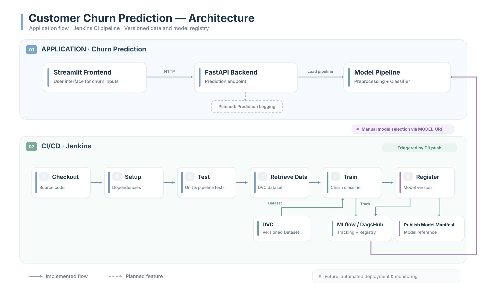

# Customer Churn Prediction

Predict customer churn through a FastAPI API and a Streamlit application. Random Forest and XGBoost experiments are tracked with MLflow on DagsHub; customer data is versioned with DVC.

## Features

- Individual customer predictions with a validated JSON request.
- Batch predictions from uploaded CSV files.
- Streamlit form, CSV upload, and embedded Power BI dashboard.
- Shared feature contract across training, JSON, and CSV inputs.
- Training pipelines that fit preprocessing on the training split and log it with the classifier.
- Selection of the highest macro-F1 completed run within the configured experiment.
- Explicit model registration with a configurable minimum F1 score.
- Health, feature-schema, and model-information endpoints.
- Automated API/preprocessing tests and GitHub Actions checks.
- A Jenkins pipeline definition for testing, data retrieval, training, and registration.

Deepchecks reports and the Arize monitoring notebook are included as offline analysis tools. Live prediction logging, automatic deployment, and drift-triggered retraining are not implemented.

## Architecture



The diagram provides an architecture overview. Jenkins requires separate configuration. Prediction-history storage and automatic deployment are not implemented; model selection for serving is configured through `MODEL_URI`. Existing Dockerfiles are retained, but Docker Compose is not included.

## Repository structure

```text
backend/
  main.py                         FastAPI endpoints and model lifecycle
  examplejson/churn_info.py        Request validation
  src/
    features.py                   Ordered feature schema and aliases
    clean_data_csv.py              Legacy classifier preprocessing
    clean_data_json.py             Same preprocessing for JSON
    data_preprocessing_training.py Raw train/test split
    modeling.py                   Training entry point
    treatement.py                  Pipeline training and MLflow logging
    tracking.py                   Tracking configuration and run selection
frontend/front_end.py              Streamlit application
scripts/register_best_model.py     Threshold check and model registration
notebooks/                        EDA and historical experiments
testing/                          Deepchecks notebook and saved reports
tests/                            Automated tests
monitoring/                       Arize notebook and legacy processors
jenkins/Dockerfile                Existing optional Jenkins image
Jenkinsfile                       CI training and registration definition
.github/workflows/checks.yml       GitHub test workflow
requirements-dev.txt              Backend and testing dependencies
```

## Data and prediction schema

The target is `Churn`: `1` means churn and `0` means retained. `Churn` and `CustomerID` are excluded from model inputs.

| Feature | Type / accepted values |
| --- | --- |
| Age | Nonnegative integer |
| Gender | Female, Male |
| Tenure | Nonnegative integer, months |
| Usage Frequency | Nonnegative integer |
| Support Calls | Nonnegative integer |
| Payment Delay | Nonnegative integer, days |
| Subscription Type | Basic, Standard, Premium |
| Contract Length | Monthly, Quarterly, Annual |
| Total Spend | Nonnegative number |
| Last Interaction | Nonnegative integer, days |

CSV headers accept spaces or underscores. Inputs are reordered to the feature schema; identifiers and labels are excluded. JSON validates categories and numeric ranges. CSV preprocessing rejects missing/duplicate columns and missing values; it does not yet enforce every JSON field constraint. Newly trained pipelines encode unseen CSV categories with `handle_unknown="ignore"`; legacy encoders reject unseen categories.

## Configuration

No local environment, package installation, or Docker execution is required merely to publish this repository. The commands below are for running it later with dependencies already available, or on a CI/deployment machine.

Provide credentials through the process environment or your hosting service's secret settings. Do not commit tokens.

| Variable | Purpose / default |
| --- | --- |
| `MLFLOW_TRACKING_URI` | Defaults to `https://dagshub.com/rami4real/mymlproject.mlflow` |
| `MLFLOW_TRACKING_USERNAME` | DagsHub username; supply externally |
| `MLFLOW_TRACKING_PASSWORD` | DagsHub token; supply externally |
| `MLFLOW_EXPERIMENT_NAME` | Defaults to `churn-experiment` |
| `MODEL_URI` | Optional exact MLflow model URI; otherwise select highest macro F1 |
| `CORS_ORIGINS` | Comma-separated frontend origins; defaults to `*` without credentials |
| `BACKEND_URL` | Streamlit API URL; defaults to `http://localhost:8080` |

For an existing Bash session:

```bash
export MLFLOW_TRACKING_USERNAME="your-dagshub-username"
read -rsp "DagsHub token: " MLFLOW_TRACKING_PASSWORD
printf '\n'
export MLFLOW_TRACKING_PASSWORD
```

Previously committed credentials must be revoked in DagsHub. Removing a value from current files does not erase it from Git history. Local `.env` files are ignored and are not automatically loaded by these entry points.

## Run the application

From the repository root, using an existing Python installation with the required packages:

```bash
python3 -m uvicorn backend.main:app --host 0.0.0.0 --port 8080
```

In a second terminal:

```bash
python3 -m streamlit run frontend/front_end.py
```

- Frontend: <http://localhost:8501>
- API documentation: <http://localhost:8080/docs>
- Readiness: <http://localhost:8080/health>

Backend dependencies are declared in `backend/requirements.txt`; frontend dependencies are in `frontend/requirements.txt`. `requirements-dev.txt` adds the API test dependencies. Notebook tooling such as DVC, Deepchecks, and Arize is separate from the serving dependencies.

## Train and register

Restore data using the existing DVC configuration; do not initialize DVC again:

```bash
dvc pull
python3 -m backend.src.modeling --data data/customer_churn_dataset.csv --version v2.0
python3 -m pytest -q
python3 -m scripts.register_best_model --min-f1 0.80
```

The threshold is an example, not a validated business requirement. Choose a value appropriate for your data. Registration writes an ignored `artifacts/production_model.json` manifest containing the immutable model URI and registered version. Set `MODEL_URI` to that URI when serving; registration does not deploy or restart the app.

Training splits raw records with stratification before fitting preprocessing. Each model contains its own numeric scaler and categorical encoder. Macro precision, recall, and F1 are logged to MLflow. Do not repeatedly tune against the held-out split; a separate final evaluation dataset is recommended before production promotion.

### Existing models

The API continues to support older standalone classifiers using the bundled `backend/*Final.pkl` processors. New pipeline models carry `input_format: raw-v1` metadata and perform their own preprocessing. Existing remote artifacts are not modified by this repository update. Models produced by the historical training script with the target included must be retrained; they are incompatible with the intended prediction schema. Historical notebooks remain research references; the module entry point above is the maintained training workflow.

## API example

```bash
curl -X POST http://localhost:8080/predict \
  -H 'Content-Type: application/json' \
  -d '{"Age":22,"Gender":"Female","Tenure":25,"Usage Frequency":14,"Support Calls":4,"Payment Delay":27,"Subscription Type":"Basic","Contract Length":"Monthly","Total Spend":598.5,"Last Interaction":9}'

curl -X POST http://localhost:8080/predict/csv \
  -F 'file=@customers.csv'
```

Both routes return `{"predictions": [...]}`. `/features` returns the ordered schema; `/model-info` reports the selected model URI. `/health` returns HTTP 503 when a model could not be loaded. Model loading is attempted at startup; fix the configuration and restart the service after a failure.

## CI and monitoring

GitHub Actions runs isolated API and preprocessing tests without DagsHub credentials or a downloaded dataset. Model loading is mocked in API tests; these tests do not establish model accuracy.

To use Jenkins later, configure a Linux agent with Python, venv support, Git, and network access. Add a Secret Text credential named `dagshub-token`, configure this repository's `Jenkinsfile`, and set the `MIN_F1` parameter. The pipeline installs its dependencies on the CI agent, retrieves DVC data, trains the models, and registers a qualifying candidate. It performs no Docker operations or automatic deployment. Configure a webhook or polling separately if push-triggered execution is desired.

The Arize notebook requires externally supplied account credentials. Saved Deepchecks HTML files are historical reports, not current CI results.
